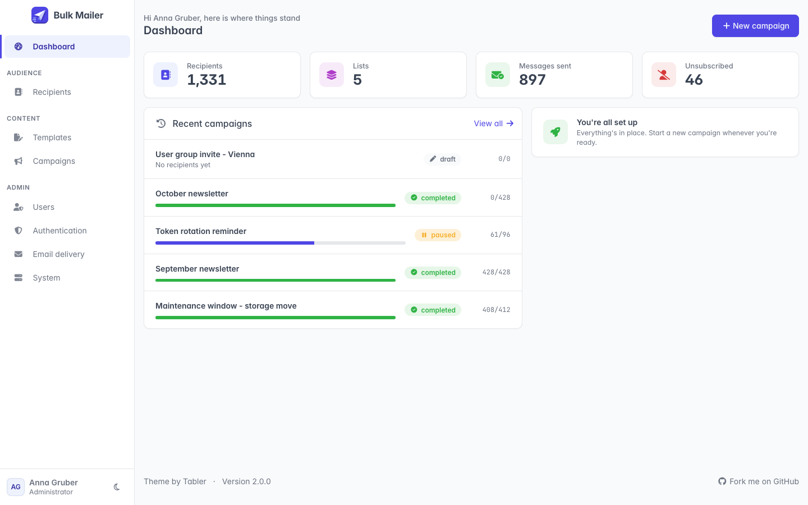

<p align="center">
  <picture>
    <source media="(prefers-color-scheme: dark)" srcset="assets/logo-wordmark-dark.svg">
    
  </picture>
  <br><br>
  <a href="https://github.com/timothestoifl24/bulk-mailer/releases/latest"></a>
  <a href="https://hub.docker.com/r/timothestoifl24/bulk-mailer"></a>
  <a href="LICENSE"></a>
</p>

Bulk Mailer sends one message to many recipients: typed in, pasted, uploaded as CSV, or pulled straight
from LDAP / Active Directory. It comes as one container image on SQLite or PostgreSQL, renders every page
on the server, and runs fully offline on an isolated network.

- [Quick Setup](#quick-setup)
- [Full Setup](https://bulkmailer.timothestoifl24.dev/setup/)
- [Guide](https://bulkmailer.timothestoifl24.dev/guide)
- [Screenshots](https://bulkmailer.timothestoifl24.dev/screenshots)

<p align="center">
  
</p>

<a href="https://ko-fi.com/Z4F028KJ68"></a>

##  Features

- Recipients typed in, pasted, uploaded as CSV or imported from LDAP / Active Directory, with a review before anything is written
- Lists that stay in sync with the directory search or group that filled them
- Templates with per-recipient placeholders, rendered in a sandbox, and a live preview on real data
- A dry run that renders and checks every message without delivering anything
- Throttled sending with live progress, pause, resume, cancel and retry-only-the-failures
- One-click unsubscribe and `List-Unsubscribe` headers, honoured by every later campaign
- Admin interface based on [Tabler](https://tabler.io), with sign-in through local accounts, LDAP or OpenID Connect

<a id="quick-setup"></a>

##  Quick Setup

1. [Install Docker](https://docs.docker.com/get-docker/)
2. Create a `compose.yaml` file similar to this:

```yaml
services:
  app:
    image: docker.io/timothestoifl24/bulk-mailer:latest
    restart: unless-stopped
    ports:
      - "8000:8000"
    environment:
      SECRET_KEY: change-me-to-a-long-random-string
    volumes:
      - mailer-data:/data
volumes:
  mailer-data:
```

3. Bring up your stack by running

```bash
docker compose up -d
```

4. Open [http://127.0.0.1:8000](http://127.0.0.1:8000) and create the first administrator on the setup page

This is the bare minimum, on SQLite. See the [documentation](https://bulkmailer.timothestoifl24.dev/setup/) for
PostgreSQL, Kubernetes, HTTPS and the [configuration reference](https://bulkmailer.timothestoifl24.dev/advanced-config).

##  Contributing

Pull requests are welcome against the `develop` branch; official releases are made from `main`.
Please read [CONTRIBUTING.md](CONTRIBUTING.md) first.

Documentation for `develop` is available for preview at
[bulkmailer.timothestoifl24.dev/dev](https://bulkmailer.timothestoifl24.dev/dev/).

##  Getting Support

1. [Found a bug?](https://github.com/timothestoifl24/bulk-mailer/issues)
2. [Have a question?](https://github.com/timothestoifl24/bulk-mailer/discussions)
3. [Found a vulnerability?](https://github.com/timothestoifl24/bulk-mailer/security/advisories/new) See [SECURITY.md](SECURITY.md).

##  License

Bulk Mailer is released under the [MIT License](LICENSE).
